### A little about me...

```java
public record DevNidhogg(
    String location,
    String focus,
    List<String> interests
) {
    public static DevNidhogg profile() {
        return new DevNidhogg(
            "Brazil",
            "Java & Backend",
            List.of("Software Architecture", "Distributed Systems",
                    "Cybersecurity", "Artificial Intelligence")
        );
    }
}
```

---

<table>
<tr>
<td width="52%" valign="top">

### Technologies & Tools

Java · Python · SQL  
Docker · gRPC · Kafka  
AWS · Git

</td>
<td width="48%" valign="top">

### Current Focus

- System Design & Architecture
- High-Performance Backend
- AI Integration (Local & On-Premise)
- Cloud & DevOps

</td>
</tr>
</table>


