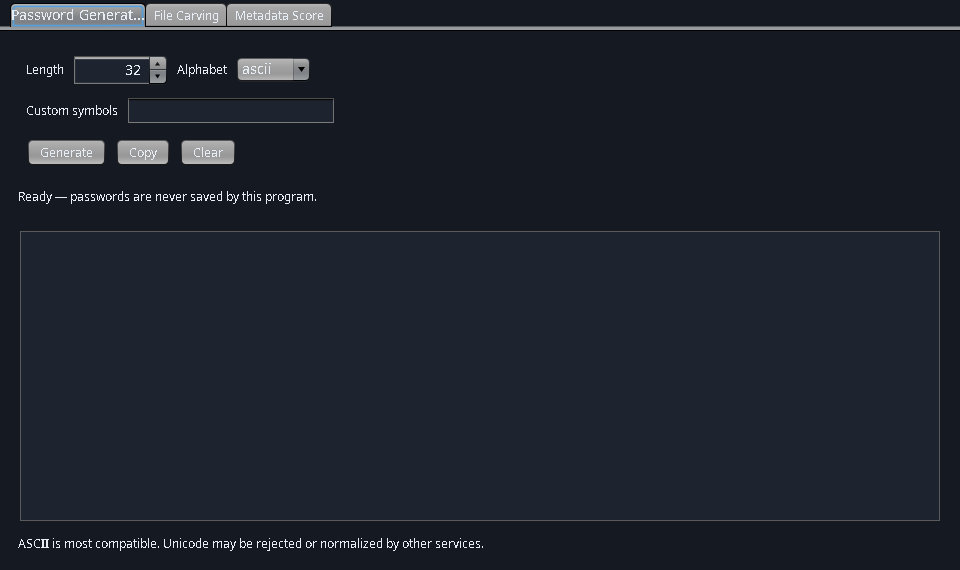
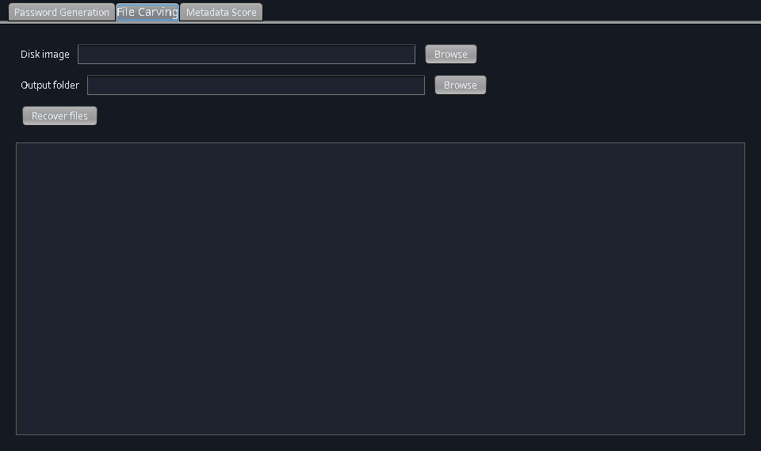
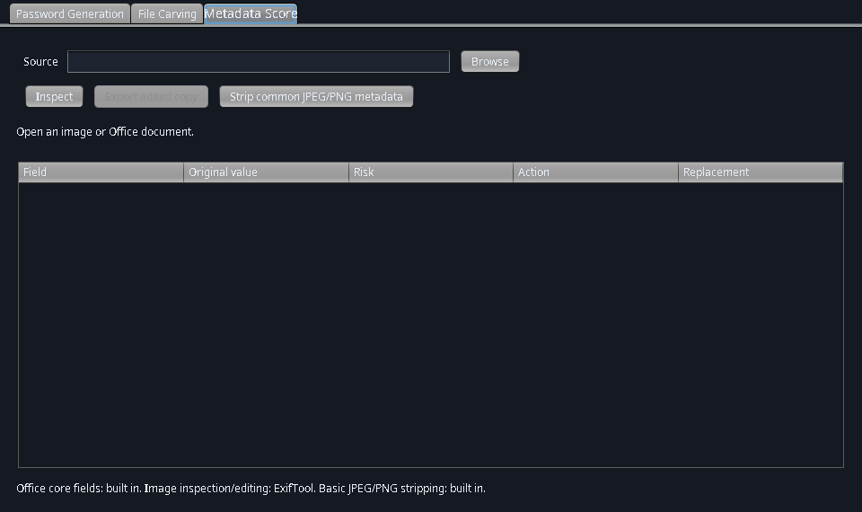

# Java Applied Systems

Local desktop utilities for credential generation, binary recovery and metadata privacy. Java 21 · Swing · JCA · Java NIO · ZIP/XML · ExifTool (optional for basic use; required for selective image editing).

## Run

**Windows:** extract the ZIP and double-click `run.bat`. The release contains `app.jar`; Java 21 or later is required. For a source checkout, `run.bat` compiles automatically using JDK 21. Linux/macOS: `sh run.sh`. The individual project launchers open the corresponding tab. No account, network access or server is needed by the Java applications.

## Password Generation



- Uniform independent selection using `SecureRandom.nextInt` over a deduplicated Unicode code-point pool. Default: 94 printable ASCII characters excluding spaces. Options: Greek, Cyrillic, Hebrew, Arabic, mixed, custom and random additional alphabet. Random chooses one additional alphabet per generation, then samples every character independently.
- Length 1–4096 code points. The reported `L × log2(N)` is theoretical entropy conditional on the selected pool, not a strength guarantee for reused or disclosed passwords. No forced class insertion. Custom combining marks, controls and format characters are excluded.
- Copy and clear controls. Copying exposes the password to the system clipboard/history; clearing the UI does not erase the clipboard or guarantee memory erasure. Unicode may be rejected/normalized by target services. ASCII is the compatibility default.

## File Carving



Select a **read-only disk image file** (`.img`, `.raw`, `.dd` or another regular binary file) and a destination directory, preferably on another device. Do not run against a live drive. No recovered file is automatically opened. The original file is never written.

| Format | Recovery boundary | Validation label |
|---|---|---|
| PNG | Signature, chunks and IEND | chunk-crc: every chunk CRC checked |
| JPEG | SOI, segment lengths, scan data and EOI | marker-structure: handles embedded APP payloads, stuffed bytes and restart markers |
| ZIP | Local header and EOCD | central-directory: opens directory without extracting entries |
| PDF | Header and first EOF marker | signature-only: requires manual inspection |

The scanner streams the source and reads footer searches in 64 KiB buffers. Each candidate is saved with its original hexadecimal offset, format and a unique suffix. TSV reports include offset, length, SHA-256 and validation level. Default candidate cap: 256 MiB, adjustable via `java -Dcarving.maxMiB=512 -jar app.jar 1` (1–4096 MiB). Maximum 1,000 recovered candidates and 10,000 signature attempts; a scan that reaches limits is incomplete. Fragmented files, ZIP64 and incremental PDF recovery are not fully supported. This is signature carving, not filesystem reconstruction, and cannot recover overwritten data. Keep the source unchanged throughout the scan. Do not treat reports as evidence of complete forensic validation.

## Metadata Score



- Open DOCX/XLSX/PPTX core properties with Java alone. Choose `Keep`, `Replace` or `Remove` in the table; enter replacement text (for example `google.com`) and export to a new file. The Office exporter stages changes, re-inspects selected fields and verifies them before publishing the copy.
- Install [ExifTool](https://exiftool.org/) for inspection and selective EXIF/IPTC/XMP/GPS editing. Add its executable to PATH or set `EXIFTOOL` to its full executable path. On Windows, follow the official ExifTool installation instructions; the image integration was not exercised in this build environment. Select existing writable tags and inspect the exported result; normalized values and read-only tags may behave differently. PDF is inspection-only.
- Without ExifTool, `Strip common JPEG/PNG metadata` removes JPEG APP1/APP13/COM segments before the first image scan, or PNG tEXt/zTXt/iTXt/eXIf/tIME chunks, without re-encoding pixels. PNG CRC is checked. Output is staged and existing files are not overwritten. JPEG orientation may change if EXIF is removed. Embedded/private chunks, ICC profiles, metadata between JPEG scans, Office embedded documents, comments, revisions and custom parts can remain. This is not an anonymity guarantee.

Score: heuristic sum of 30 for location/serial tags, 20 for authorship/identity tags, 5 for device/date/comment fields, capped at 100. It is not a calibrated probability or a comprehensive risk assessment. Re-inspect every exported file before sharing.

## Architecture

```
Swing desktop (EDT)
  ├── PasswordGeneration : CSPRNG / Unicode pool / entropy
  ├── FileCarving        : buffered scan / format boundaries / SHA-256 / TSV
  └── MetadataScore      : core XML / ZIP copy / ExifTool process
       └── Desktop.stripImage : binary JPEG/PNG copy
```

File operations execute in a SwingWorker. Engine classes also retain terminal entry points. External ExifTool is invoked with argument arrays rather than shell commands. XML parsing disables DTD and external entity access. The build uses the JDK alone.

## Verification

```sh
sh build.sh
javac -encoding UTF-8 -cp build -d build SmokeTest.java
java -cp build PasswordGeneration --self-test
java -cp build FileCarving --self-test
java -cp build MetadataScore --self-test
java -cp build Desktop --self-test
java -cp build SmokeTest
```

`SmokeTest` covers 24 password configurations, real PNG/JPEG/ZIP recovery with exact byte equality and original preservation, JPEG APP1 and PNG text stripping, overwrite prevention and corrupt PNG rejection. The Office self-test covers replacement/removal and original preservation. The test fixtures are synthetic and generated locally. The GUI was launched on Linux under a virtual display; Windows runtime and ExifTool integration have not been validated. See `TEST-RESULTS.txt` in the release for the actual local output.
